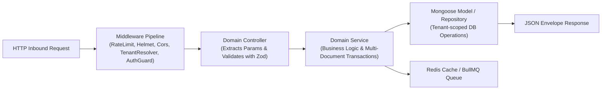

# API Specification, Module Architecture & Routing Directory
## Document Version: 1.0.0 — Phase 01 Master Architecture
**Platform**: NEXORA Multi-Tenant SaaS E-Commerce Store Builder  
**Author**: Principal Software Architect & API Engineering Team  
**Status**: APPROVED

---

## 1. Architectural Pattern: Layered Domain Services

All backend services follow the **Controller-Service-Repository** pattern with strict dependency injection and Zod schema validation:



---

## 2. Standard API Response Envelope

Every endpoint in the NEXORA API returns a standardized JSON contract:

### Success Contract:
```json
{
  "success": true,
  "data": { ... },
  "meta": {
    "page": 1,
    "pageSize": 20,
    "totalCount": 142,
    "totalPages": 8,
    "timestamp": "2026-11-10T05:17:15.000Z"
  }
}
```

### Error Contract:
```json
{
  "success": false,
  "error": {
    "code": "INSUFFICIENT_INVENTORY",
    "message": "Item 'Navy Blue Shirt (XL)' has only 2 units available in stock.",
    "details": [
      {
        "field": "items[0].quantity",
        "requested": 5,
        "available": 2
      }
    ],
    "traceId": "req_8f192b04-8b1e-450a-9d33"
  }
}
```

---

## 3. Comprehensive Routing Directory

### 3.1 Authentication & Session Domain (`/api/v1/auth`)
- `POST /register-tenant`: Onboard new merchant, create tenant, initial staff account, trial plan.
- `POST /login`: Primary authentication (Argon2id verify, issues short-lived JWT + HttpOnly refresh cookie).
- `POST /refresh`: Rotates refresh token in cookie and returns fresh access token.
- `POST /logout`: Revokes active refresh token in Redis and clears cookie.
- `POST /mfa/setup`: Generates TOTP secret and QR code data URL.
- `POST /mfa/verify`: Validates TOTP token and activates two-factor authentication.
- `POST /mfa/backup-codes/generate`: Generates 10 single-use emergency backup codes.

### 3.2 Platform Super Admin Domain (`/api/v1/platform`)
- `GET /tenants`: Paginated list of all stores with status, plan, revenue, and product counts.
- `GET /tenants/:id`: Deep tenant inspection including domain status, health, and storage usage.
- `PATCH /tenants/:id/status`: Suspend, reactivate, or archive tenant store.
- `GET /plans`: List SaaS subscription tiers and limits.
- `POST /plans`: Create new subscription plan tier.
- `PUT /plans/:id`: Update plan pricing, storage limits, and feature toggles.
- `GET /metrics/overview`: Platform-wide GMV, active stores, new registrations, and subscription MRR.
- `GET /audit-logs`: Global platform security audit stream.

### 3.3 Tenant Admin & Merchant Operations Domain (`/api/v1/tenant`)
- `GET /dashboard/metrics`: Real-time sales, order counts, low stock alerts, revenue graph.
- `GET /products`: Filtered product list (SKU, title, category, stock level).
- `POST /products`: Create product with variants, barcodes, pricing, and images.
- `GET /products/:id`: Fetch product with full variant matrix.
- `PUT /products/:id`: Update product attributes, images, SEO, and variants.
- `DELETE /products/:id`: Soft delete or archive product.
- `GET /orders`: Merchant order stream with status filters (`PENDING`, `PROCESSING`, etc.).
- `GET /orders/:id`: Full order details, customer notes, timeline, payment ledger.
- `PATCH /orders/:id/status`: Progress order state (e.g., mark `SHIPPED` with tracking number).
- `POST /orders/:id/refund`: Initiate partial or full refund through configured gateway.
- `GET /inventory/logs`: Stock mutation ledger (sales, manual adjustments, restocks).
- `POST /inventory/adjust`: Manual inventory count reconciliation.
- `GET /theme`: Current theme configuration (draft and published tokens).
- `PUT /theme/draft`: Save working style draft in Theme Studio.
- `POST /theme/publish`: Promote draft to live storefront with version snapshot.
- `POST /theme/rollback/:revisionId`: Instantly roll back to previous theme snapshot.
- `GET /payment-configs`: List configured payment gateways (status and test mode).
- `PUT /payment-configs/:gateway`: Save encrypted credentials (bKash app secret, SSLCommerz store ID, etc.).
- `GET /ad-config`: AdSense publisher ID and placement unit settings.
- `PUT /ad-config`: Update ad slots, consent settings, or auto-ad toggles.
- `GET /staff`: List store employees and assigned permission roles.
- `POST /staff`: Invite new staff member with granular role permissions.
- `GET /domains`: Status of subdomain and custom domains (DNS verification, SSL status).
- `POST /domains/custom`: Add custom domain and generate DNS CNAME verification tokens.

### 3.4 Public Shopper Storefront Domain (`/api/v1/storefront`)
- `GET /config`: Public store metadata, published theme CSS tokens, active currency, and logo.
- `GET /products`: Multi-faceted search and filter catalog (price slider, category tree, variants).
- `GET /products/:slug`: Single product detail view with real-time stock availability.
- `GET /categories`: Storefront category navigation hierarchy.
- `POST /cart/validate`: Validate cart items, re-check live inventory, apply coupon rules.
- `POST /orders`: Checkout submission — reserves stock, validates pricing, generates order record.
- `GET /orders/:orderNumber`: Public order tracking status page.
- `POST /orders/:id/pay`: Initiate payment gateway session (redirects to bKash/SSL/Stripe).
- `GET /ads/slots`: Fetch active ad unit placements for current route (suppressed on checkout).

### 3.5 Payment Gateway Webhook Domain (`/api/v1/webhooks`)
- `POST /bkash`: bKash IPN / Tokenized webhook with signature validation.
- `POST /nagad`: Nagad callback endpoint with public-key signature verification.
- `POST /sslcommerz`: SSLCommerz Instant Payment Notification (IPN) with verification API callback.
- `POST /stripe`: Stripe signed webhook (`stripe-signature` verification).
- `POST /paypal`: PayPal webhook event ingress (`PAYMENT.CAPTURE.COMPLETED`).
