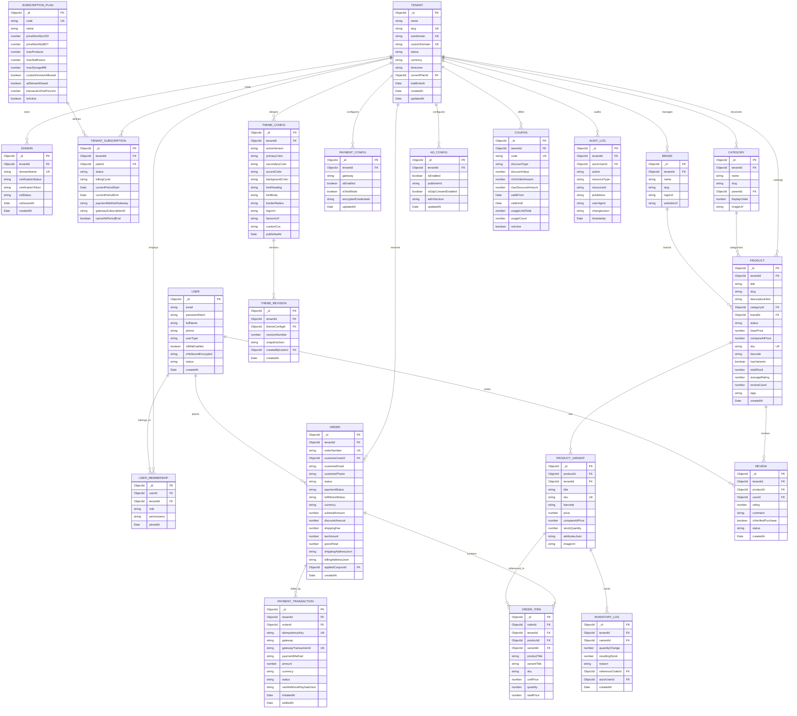

# Database Entity Relationship Diagrams & Collection Schemas
## Document Version: 1.0.0 — Phase 01 Master Architecture
**Platform**: NEXORA Multi-Tenant SaaS E-Commerce Store Builder  
**Author**: Principal Database Architect & Senior MERN Engineer  
**Status**: APPROVED

---

## 1. Complete System Entity Relationship Diagram (ERD)



---

## 2. Detailed Collection Blueprints & Indexing Specifications

### 2.1 Collection: `tenants`
Stores autonomous merchant store profiles, status, and domain mappings.

```typescript
interface ITenant {
  _id: Types.ObjectId;
  name: string;                         // Store commercial name (e.g., "Apex Footwear")
  slug: string;                         // Canonical slug (e.g., "apex")
  subdomain: string;                    // Subdomain: apex.nexora.shop
  customDomain?: string;                // apexfootwear.com.bd (optional)
  ownerUserId: Types.ObjectId;          // Store primary creator
  currentPlanId: Types.ObjectId;        // References subscription_plans
  status: 'TRIAL' | 'ACTIVE' | 'PAST_DUE' | 'SUSPENDED' | 'ARCHIVED';
  currency: 'BDT' | 'USD' | 'EUR' | 'GBP';
  timezone: string;                     // e.g. "Asia/Dhaka"
  isOfficialStore: boolean;             // TRUE ONLY for T_NEXORA_OFFICIAL
  contactEmail: string;
  contactPhone: string;
  trialEndsAt: Date;
  storageUsedMB: number;
  productCount: number;
  createdAt: Date;
  updatedAt: Date;
}
```
**Indexes**:
- `{ subdomain: 1 }` (Unique)
- `{ customDomain: 1 }` (Unique, Sparse)
- `{ slug: 1 }` (Unique)
- `{ status: 1 }`
- `{ ownerUserId: 1 }`

---

### 2.2 Collection: `products` & `product_variants`
Manages sovereign catalog, inventory, and variant matrices.

```typescript
interface IProduct {
  _id: Types.ObjectId;
  tenantId: Types.ObjectId;             // Mandatory isolation key
  title: string;
  slug: string;                         // Unique per tenant
  descriptionHtml: string;
  categoryId: Types.ObjectId;
  brandId?: Types.ObjectId;
  status: 'DRAFT' | 'ACTIVE' | 'ARCHIVED';
  basePrice: number;                    // Monetary integer or decimal representation
  compareAtPrice?: number;              // Crossed-out original price
  sku: string;                          // Stock Keeping Unit
  barcode?: string;                     // EAN-13, UPC, or Code-128
  hasVariants: boolean;
  totalStock: number;                   // Denormalized rollup of variant stocks
  averageRating: number;                // 0.00 to 5.00
  reviewCount: number;
  tags: string[];                       // ["summer", "cotton", "panjabi"]
  attributes: Array<{
    name: string;                       // e.g. "Material", "Warranty"
    values: string[];
  }>;
  images: Array<{
    url: string;
    altText?: string;
    isPrimary: boolean;
    displayOrder: number;
  }>;
  seo: {
    metaTitle?: string;
    metaDescription?: string;
    keywords?: string[];
  };
  createdAt: Date;
  updatedAt: Date;
}

interface IProductVariant {
  _id: Types.ObjectId;
  tenantId: Types.ObjectId;             // Mandatory isolation key
  productId: Types.ObjectId;
  title: string;                        // e.g., "Size: XL, Color: Navy Blue"
  sku: string;
  barcode?: string;
  price: number;
  compareAtPrice?: number;
  stockQuantity: number;
  attributes: Record<string, string>;   // { "Size": "XL", "Color": "Navy Blue" }
  imageUrl?: string;
  weightInGrams?: number;
  isDefault: boolean;
  createdAt: Date;
}
```
**Compound Indexes**:
- `{ tenantId: 1, slug: 1 }` (Unique — prevents slug collision within a tenant)
- `{ tenantId: 1, sku: 1 }` (Unique — enforces SKU uniqueness per store)
- `{ tenantId: 1, categoryId: 1, status: 1 }` (Fast storefront catalog lookups)
- `{ tenantId: 1, basePrice: 1, status: 1 }` (Price range filtering & sorting)
- `{ tenantId: 1, averageRating: -1 }` (Popularity / rating sort)
- `{ tenantId: 1, title: 'text', descriptionHtml: 'text', tags: 'text' }` (Full-text search index with Bengali and English language weights)

---

### 2.3 Collection: `orders` & `order_items`
Immutable transaction ledger representing financial commitments.

```typescript
interface IOrder {
  _id: Types.ObjectId;
  tenantId: Types.ObjectId;             // Mandatory isolation key
  orderNumber: string;                  // e.g., "NEX-APEX-10492" (Unique per tenant)
  customerUserId?: Types.ObjectId;      // Nullable for Guest Checkout
  customerEmail: string;
  customerPhone: string;
  status: 'PENDING' | 'CONFIRMED' | 'PROCESSING' | 'SHIPPED' | 'DELIVERED' | 'CANCELLED' | 'REFUNDED';
  paymentStatus: 'UNPAID' | 'AUTHORIZED' | 'PAID' | 'PARTIALLY_REFUNDED' | 'REFUNDED' | 'FAILED';
  fulfillmentStatus: 'UNFULFILLED' | 'PARTIAL' | 'FULFILLED';
  currency: 'BDT' | 'USD';
  subtotalAmount: number;
  discountAmount: number;
  shippingFee: number;
  taxAmount: number;
  grandTotal: number;
  shippingAddress: {
    recipientName: string;
    phone: string;
    addressLine1: string;
    city: string;
    stateOrDivision: string;            // e.g. "Dhaka", "Chittagong"
    postalCode: string;
    country: string;
  };
  billingAddress: {
    recipientName: string;
    phone: string;
    addressLine1: string;
    city: string;
    postalCode: string;
    country: string;
  };
  appliedCoupon?: {
    code: string;
    discountType: 'PERCENT' | 'FIXED';
    discountValue: number;
  };
  notes?: string;
  createdAt: Date;
  updatedAt: Date;
}

interface IOrderItem {
  _id: Types.ObjectId;
  tenantId: Types.ObjectId;
  orderId: Types.ObjectId;
  productId: Types.ObjectId;
  variantId: Types.ObjectId;
  productTitle: string;
  variantTitle: string;
  sku: string;
  unitPrice: number;
  quantity: number;
  totalPrice: number;
}
```
**Compound Indexes**:
- `{ tenantId: 1, orderNumber: 1 }` (Unique)
- `{ tenantId: 1, customerUserId: 1, createdAt: -1 }` (Customer order history)
- `{ tenantId: 1, status: 1, paymentStatus: 1, createdAt: -1 }` (Merchant order dashboard filtering)
- `{ tenantId: 1, customerPhone: 1 }` (Customer phone order lookup)

---

### 2.4 Collection: `payment_transactions`
Payment gateway ledger preserving raw webhook payloads and audit trails.

```typescript
interface IPaymentTransaction {
  _id: Types.ObjectId;
  tenantId: Types.ObjectId;
  orderId: Types.ObjectId;
  idempotencyKey: string;               // UUID v4 from checkout submission
  gateway: 'BKASH' | 'NAGAD' | 'ROCKET' | 'SSLCOMMERZ' | 'STRIPE' | 'PAYPAL' | 'BANK_TRANSFER' | 'COD';
  gatewayTransactionId?: string;        // Gateway reference (trxID from bKash, val_id from SSL)
  paymentMethodDetails?: string;        // e.g., "bKash Mobile App", "Visa ending in 4242"
  amount: number;
  currency: string;
  status: 'INITIATED' | 'PENDING' | 'SUCCESS' | 'FAILED' | 'REVERSED';
  failureReason?: string;
  rawWebhookPayload?: Record<string, unknown>;
  initiatedAt: Date;
  settledAt?: Date;
}
```
**Compound Indexes**:
- `{ tenantId: 1, idempotencyKey: 1 }` (Unique — prevents duplicate charge execution)
- `{ gateway: 1, gatewayTransactionId: 1 }` (Unique, Sparse — handles webhook reconciliation)
- `{ tenantId: 1, orderId: 1 }`

---

### 2.5 Collection: `payment_configs`
Stores tenant-configured credentials with AES-256-GCM envelope encryption.

```typescript
interface IPaymentConfig {
  _id: Types.ObjectId;
  tenantId: Types.ObjectId;
  gateway: 'BKASH' | 'NAGAD' | 'ROCKET' | 'SSLCOMMERZ' | 'STRIPE' | 'PAYPAL' | 'BANK_TRANSFER' | 'COD';
  isEnabled: boolean;
  isTestMode: boolean;
  // Encrypted payload contains appKey, appSecret, merchantNumber, etc.
  encryptedCredentials: {
    iv: string;                         // Initialization vector (hex)
    tag: string;                        // Auth tag for GCM integrity (hex)
    ciphertext: string;                 // Encrypted JSON string (hex)
  };
  instructionsForCustomer?: string;     // For Bank Transfer / Cash on Delivery
  updatedAt: Date;
}
```
**Compound Indexes**:
- `{ tenantId: 1, gateway: 1 }` (Unique)

---

### 2.6 Collection: `theme_configs` & `theme_revisions`
Supports dynamic styling, real-time draft/publish states, and version rollback.

```typescript
interface IThemeConfig {
  _id: Types.ObjectId;
  tenantId: Types.ObjectId;             // Mandatory isolation key
  activeVersion: number;
  publishedSnapshot: IThemeTokens;
  draftSnapshot: IThemeTokens;
  publishedAt?: Date;
  updatedAt: Date;
}

interface IThemeTokens {
  colors: {
    primary: string;                    // Hex: #0F172A
    primaryForeground: string;          // Hex: #FFFFFF
    secondary: string;
    accent: string;
    background: string;
    surface: string;
    textPrimary: string;
    textSecondary: string;
    border: string;
  };
  typography: {
    headingFont: string;                // e.g., "Plus Jakarta Sans", "Hind Siliguri"
    bodyFont: string;                   // e.g., "Inter", "Noto Sans Bengali"
  };
  layout: {
    borderRadius: 'none' | 'sm' | 'md' | 'lg' | 'full';
    containerMaxWidth: '1200px' | '1440px' | 'full';
    headerStyle: 'standard' | 'minimal' | 'sticky';
  };
  branding: {
    logoUrl?: string;
    faviconUrl?: string;
    tagline?: string;
  };
}

interface IThemeRevision {
  _id: Types.ObjectId;
  tenantId: Types.ObjectId;
  revisionNumber: number;
  snapshot: IThemeTokens;
  createdByUserId: Types.ObjectId;
  changeSummary: string;
  createdAt: Date;
}
```

---

### 2.7 Collection: `ad_configs`
Tenant-scoped Google AdSense and promotional banner governance.

```typescript
interface IAdConfig {
  _id: Types.ObjectId;
  tenantId: Types.ObjectId;
  isEnabled: boolean;                   // Master toggle
  publisherId: string;                  // e.g. "ca-pub-1234567890123456"
  isGdpConsentEnabled: boolean;         // CMP / Consent banner toggle
  autoAdsEnabled: boolean;
  adUnits: Array<{
    slotId: string;                     // e.g. "1234567890"
    placementName: 'HEADER_LEADERBOARD' | 'SIDEBAR_RECTANGLE' | 'IN_FEED_NATIVE' | 'AFTER_PRODUCT_DETAILS' | 'FOOTER_BANNER';
    format: 'auto' | 'rectangle' | 'horizontal' | 'vertical';
    isResponsive: boolean;
    isActive: boolean;
  }>;
  excludedRoutes: string[];             // Strict default: ["/checkout", "/cart", "/account", "/payment"]
  updatedAt: Date;
}
```
