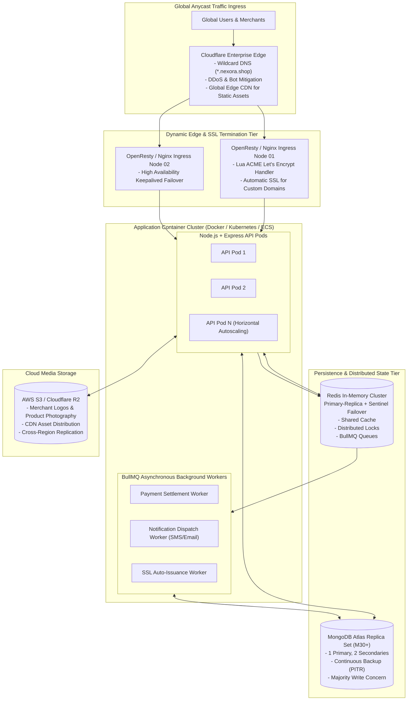
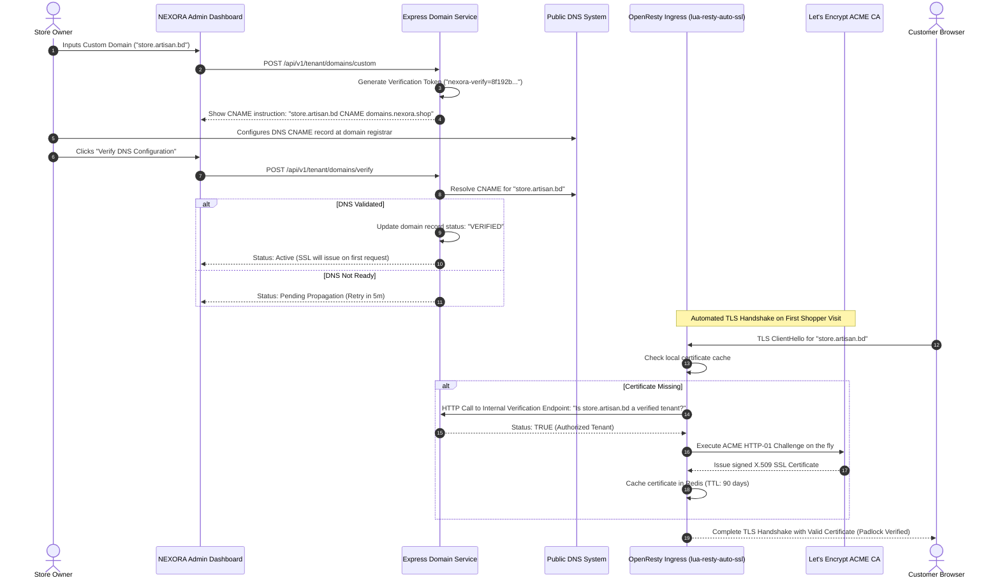

# DevOps, Infrastructure & Deployment Architecture
## Document Version: 1.0.0 — Phase 01 Master Architecture
**Platform**: NEXORA Multi-Tenant SaaS E-Commerce Store Builder  
**Author**: Principal Cloud Architect & Senior DevOps Engineer  
**Status**: APPROVED

---

## 1. High-Availability Production Topology



---

## 2. Dynamic SSL Provisioning for Custom Merchant Domains

One of the most complex challenges in multi-tenant SaaS is provisioning valid SSL/TLS certificates for customer-owned domains (`store.artisan.bd`) without human intervention or server downtime.



---

## 3. Production Dockerfile Multi-Stage Blueprint

```dockerfile
# Multi-Stage Production Build for NEXORA Full-Stack Server
FROM node:22-alpine AS builder
WORKDIR /app
COPY package*.json ./
RUN npm ci --prefer-offline
COPY . .
RUN npm run build

FROM node:22-alpine AS runner
WORKDIR /app
ENV NODE_ENV=production
ENV PORT=3000
RUN apk add --no-cache curl
COPY package*.json ./
RUN npm ci --only=production --prefer-offline && npm cache clean --force
COPY --from=builder /app/dist ./dist
COPY --from=builder /app/server.ts ./server.ts

USER node
EXPOSE 3000
HEALTHCHECK --interval=30s --timeout=5s --start-period=10s --retries=3 \
  CMD curl -f http://localhost:3000/api/health || exit 1

CMD ["node", "dist/server.js"]
```

---

## 4. Disaster Recovery & Business Continuity Plan

| Metric | Target SLA | Strategy & Implementation |
| :--- | :--- | :--- |
| **Recovery Point Objective (RPO)** | **< 5 Minutes** | Continuous MongoDB Atlas Oplog tailing with Point-in-Time Recovery (PITR); AWS S3 / Cloudflare R2 bucket versioning. |
| **Recovery Time Objective (RTO)** | **< 30 Minutes** | Infrastructure as Code (Terraform) scripts capable of reprovisioning the complete container cluster in any secondary AWS/GCP region automatically. |
| **Database Failover** | **< 10 Seconds** | MongoDB 3-node replica set automatically elects a new primary in under 10 seconds if the leader degrades. |
| **Backup Cadence** | **Hourly Snapshots** | Automated hourly delta snapshots retained for 30 days, daily snapshots retained for 90 days, monthly snapshots retained for 1 year in cold archive storage. |
