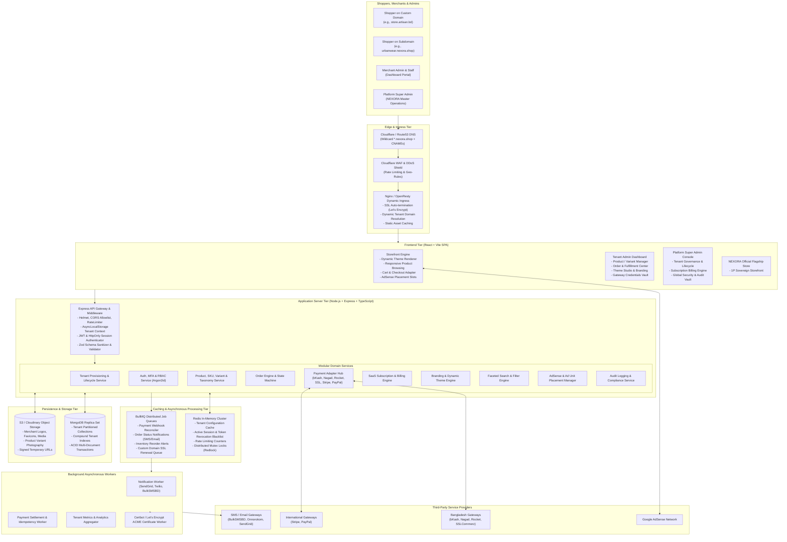
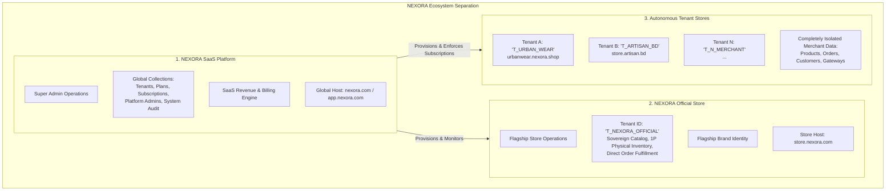

# NEXORA System Architecture Specification
## Document Version: 1.0.0 — Phase 01 Master Architecture
**Platform**: NEXORA Multi-Tenant SaaS E-Commerce Store Builder  
**Author**: Principal Software Architect & Systems Engineering Team  
**Status**: APPROVED FOR ARCHITECTURAL REVIEW (Pre-Phase 02)

---

## 1. Executive Summary & Vision

NEXORA is a high-performance, multi-tenant SaaS e-commerce store builder engineered for sovereign, isolated merchant storefronts with international and Bangladesh-localized checkout capabilities. 

Unlike traditional multi-vendor marketplaces (such as Amazon, Daraz, or Etsy) where merchant products coexist in a shared catalog and customers check out across multiple vendors simultaneously, NEXORA operates as an **Autonomous Tenant Store Builder** (analogous to Shopify or BigCommerce). Each registered merchant receives an independent e-commerce business operating on its own subdomain or custom top-level domain, with an isolated data scope, isolated customer directory, private inventory, dedicated order management, custom branding, independent payment gateway credentials, and configurable advertisement policies.

Simultaneously, the platform architecture accommodates:
1. **NEXORA SaaS Platform**: The master subscription, tenant provisioning, domain management, billing, and platform governance engine operated by the Platform Super Admin.
2. **NEXORA Official Store**: A first-party flagship retail store owned and operated by the platform owner selling physical branded goods, completely separated logically and operationally from third-party tenant stores.
3. **Tenant Stores**: Hundreds or thousands of autonomous, isolated e-commerce stores created programmatically upon merchant onboarding.

---

## 2. High-Level System Architecture

---

## 3. Tier Responsibilities & Structural Boundaries

### 3.1 Frontend Responsibilities (React, Vite, TypeScript, Tailwind CSS, Redux Toolkit)
- **Zero-Trust Client Boundary**: The frontend is treated as completely untrusted. It never computes prices, final discounts, order subtotals, tax rates, inventory deduction states, or tenant identity.
- **Dynamic Storefront Re-theming**: Reads a tenant-specific CSS Variable Token dictionary (`--nexora-primary`, `--nexora-radius`, `--nexora-font-heading`) generated server-side and injects them without full bundle recompilations.
- **Micro-State Partitioning**:
  - Global Session / Auth slice in Redux Toolkit with silent refresh interceptors.
  - Cart slice maintaining local state synced with backend reserve-stock validation.
  - Faceted Search filter slice synchronized with URL search params (`URLSearchParams`).
- **Responsive Ad Slot Host**: Provides semantic containers (`<AdSlot slotId="header-leaderboard" />`) with built-in consent wrappers (GDPR/ePrivacy compliance) and automatic suppression on checkout/sensitive routes.

### 3.2 Backend Responsibilities (Node.js, Express, TypeScript)
- **Tenant Context Assertion**: The first middleware in the pipeline resolves the incoming request's host header or authorization token to a verified `tenantId`. This is injected into Node's `AsyncLocalStorage` (`RequestContext`), ensuring that downstream services never require manual tenant ID passing that could lead to developer error.
- **Declarative Zod Validation**: Every incoming payload is validated against strict Zod schemas with `.strict()` enabled to strip any unauthorized prototype pollution or unexpected fields.
- **State Machine Integrity**: Orders, payments, and subscriptions progress through rigid state machines (e.g., `PENDING` -> `PAYMENT_AUTHORIZED` -> `PROCESSING` -> `SHIPPED` -> `DELIVERED`). Illegal transitions trigger immediate rollbacks.
- **Secrets Management**: Tenant-specific payment credentials (bKash app secrets, Stripe secret keys, SSLCommerz store passwords) are encrypted at rest using AES-256-GCM with envelope encryption before saving to the database.

### 3.3 Database Responsibilities (MongoDB Replica Set & Mongoose)
- **ACID Transactions**: Financial operations (order placement, inventory deduction, wallet balance updates) utilize MongoDB Multi-Document Transactions with `readConcern: "majority"` and `writeConcern: { w: "majority" }`.
- **Compound Tenant Indexing**: Every multi-tenant collection mandates a compound index beginning with `{ tenantId: 1, ... }` to ensure zero table scans and physical isolation within query planners.
- **Tenant Isolation Mongoose Middleware**: Global Mongoose plugins intercept `find`, `findOne`, `countDocuments`, `updateMany`, and `deleteMany` to enforce `tenantId` filtering unconditionally.

### 3.4 Caching & Queuing Responsibilities (Redis & BullMQ)
- **Redis Cache Layer**:
  - `tenant:config:<host>`: Cached tenant metadata, theme tokens, and active subscription status (TTL: 15 minutes, invalidated on admin update).
  - `auth:blacklist:<jti>`: Denied access tokens and revoked refresh tokens.
  - `rate:ip:<ip>` and `rate:tenant:<tenantId>`: Sliding-window rate limit counters.
  - Distributed locks (`Redlock`) to prevent race conditions during high-concurrency flash sales (e.g., preventing two shoppers from buying the final unit of an item).
- **BullMQ Asynchronous Job Queues**:
  - High-priority `payment-webhooks` queue with automatic exponential backoff (1s, 5s, 15s, 60s).
  - Background `email-sms-dispatch` queue to prevent external network latency from stalling API responses.
  - `analytics-rollup` queue for aggregating daily sales, store visits, and revenue.

### 3.5 Storage Responsibilities (S3-Compatible / Cloudinary)
- **Tenant-Scoped Object Keys**: All uploaded assets follow the strict key hierarchy: `tenants/{tenantId}/{category}/{uuid}-{sanitized-filename}.webp`.
- **Image Processing Pipeline**: Automated conversion to modern `.webp` and `.avif` formats with thumbnail and responsive srcset generation.
- **MIME & Magic Number Verification**: File uploads undergo binary magic number inspection (e.g., verifying `FF D8 FF` for JPEG) to prevent malicious executable uploads disguised as images.

---

## 4. Platform Separation Architecture

NEXORA structurally and operationally segregates three distinct business entities:

### Separation Rules:
1. **Tenant ID `T_NEXORA_OFFICIAL`**: The official store is treated internally as a premier tenant record with infinite subscription limits, zero commission fees, and permanent active status, ensuring it utilizes the same rock-solid storefront code path as tenants while guaranteeing that platform administrative data never touches storefront data.
2. **Customer Identity Separation**: A customer registered at `urbanwear.nexora.shop` cannot log into `store.artisan.bd` or `store.nexora.com` using the same session. User identity is strictly isolated by `(tenantId, email)`.
3. **Database Boundary**: Platform admin credentials exist in the `PlatformUsers` collection, while merchant staff and customers exist in the `TenantUsers` collection. A compromised tenant credential can never elevate to platform operations.
