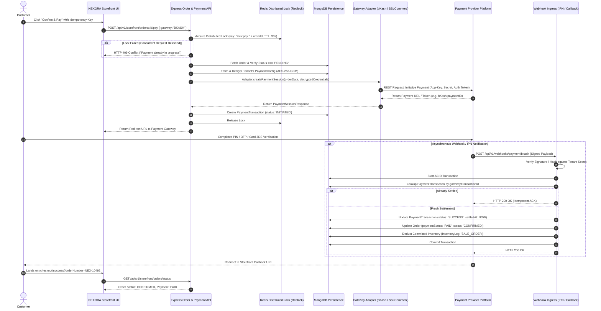

# Payment Gateway Adapter Architecture & Settlement Matrix
## Document Version: 1.0.0 — Phase 01 Master Architecture
**Platform**: NEXORA Multi-Tenant SaaS E-Commerce Store Builder  
**Author**: Principal Payment Architect & Fintech Integration Specialist  
**Status**: APPROVED

---

## 1. Gateway Support Matrix & Regulatory Eligibility Assessment

A fundamental flaw in naive e-commerce architectures is assuming that every international gateway is globally accessible to all merchants. NEXORA takes a strict, verified approach to payment eligibility, separating domestic Bangladesh-licensed gateways from international acquiring channels.

| Gateway Provider | Primary Market | Supported Currencies | Merchant Settlement Currency | Domestic Bangladesh Entity Eligibility | Integration Type | Production Status in NEXORA |
| :--- | :--- | :--- | :--- | :--- | :--- | :--- |
| **bKash** | Bangladesh | BDT | BDT (bKash Merchant Wallet / Bank) |  **Full** (Requires Trade License, TIN, BIN, Merchant Account) | Direct REST Tokenized API | **Supported & Active** |
| **Nagad** | Bangladesh | BDT | BDT (Nagad Merchant Wallet / Bank) |  **Full** (Requires Trade License, TIN, BIN) | Direct REST PGW API with RSA Keypair | **Supported & Active** |
| **Rocket (DBBL)** | Bangladesh | BDT | BDT (DBBL Account) |  **Full** (DBBL E-Commerce Merchant Agreement) | DBBL PGW Direct or Aggregator | **Supported & Active** |
| **SSLCommerz** | Bangladesh & Intl Cards | BDT (USD, EUR, GBP via foreign card acquiring) | BDT (Local Scheduled Bank Account) |  **Full** (Leading Bangladesh Payment Aggregator) | Hosted / Pop-up Checkout + IPN Webhook | **Supported & Active** |
| **Stripe** | International | 135+ Currencies (USD, EUR, GBP, etc.) | USD, EUR, GBP (Local Bank in supported countries) | ⚠️ **Restricted** (Requires Stripe Atlas / LLC or foreign corporate entity; direct BD domestic entities not natively supported for payouts) | PaymentIntents API + Webhooks | **Supported (Conditional on Merchant Legal Entity)** |
| **PayPal** | International | USD, EUR, GBP, CAD, AUD, etc. | USD, EUR (Foreign Bank Account) | ⚠️ **Restricted** (Inward commercial merchant checkout is not fully open for domestic Bangladesh personal/bank accounts) | Orders API v2 + Webhooks | **Supported (Conditional on Merchant Foreign Entity)** |
| **Bank Transfer / Cash On Delivery (COD)** | Local & Global | BDT, USD | Direct Account Deposit / Cash Settlement |  **Full** (Universal) | Offline / Manual Verification Workflow | **Supported & Active** |
| **Payoneer** | Cross-border B2B | USD, EUR, GBP, etc. | Payoneer Balance -> BD Bank Wire | ❌ **NOT A B2C CHECKOUT GATEWAY** (See Section 2 for definitive architectural analysis) | B2B Commercial Payouts / Invoicing | **Disabled for Storefront Checkout** |

---

## 2. Payoneer Integration Reality Check & Architectural Decision

### Analysis & Regulatory Context:
A frequent point of confusion among engineers is whether Payoneer can serve as a direct consumer checkout payment gateway (like Stripe or bKash) for an online retail store.

1. **Consumer Checkout Limitation**: Payoneer is primarily a **Cross-Border B2B Payment and Payout Platform**, not a direct consumer acquiring gateway designed for arbitrary retail e-commerce cart checkouts in Bangladesh. It does not provide an instant, drop-in card checkout widget equivalent to Stripe Elements or SSLCommerz for retail shoppers purchasing $20 shoes.
2. **Acceptable Use & Merchant Invoicing**: Payoneer allows business-to-business receiving accounts and payment requests between corporate clients. Requiring individual retail consumers to have a Payoneer account to purchase consumer goods introduces unacceptable cart abandonment (>95%).
3. **NEXORA Architectural Decision**:
   - **Storefront Checkout**: Payoneer is **EXCLUDED** from the public storefront consumer checkout options.
   - **Platform-to-Merchant Payouts (Future Phase)**: Payoneer may be utilized in international SaaS modules for merchants withdrawing their international store revenues, but it will NEVER be presented to a customer on a store checkout page as a payment method.

---

## 3. Universal Payment Gateway Adapter Pattern

NEXORA abstracts all payment gateways behind a unified, strongly-typed TypeScript interface (`IPaymentGatewayAdapter`). The core e-commerce order engine interacts solely with this abstraction, remaining completely agnostic to whether the underlying provider is bKash, SSLCommerz, or Stripe.

```typescript
export interface PaymentSessionRequest {
  tenantId: string;
  orderId: string;
  orderNumber: string;
  amount: number;
  currency: 'BDT' | 'USD';
  customer: {
    fullName: string;
    email: string;
    phone: string;
  };
  callbackUrls: {
    successUrl: string;
    failUrl: string;
    cancelUrl: string;
    webhookUrl: string;
  };
  metadata?: Record<string, unknown>;
}

export interface PaymentSessionResponse {
  gatewayTransactionId: string;
  redirectUrl?: string;               // URL to hosted gateway or bKash agreement page
  paymentToken?: string;              // Client-side execution token
  gatewayPayload?: Record<string, unknown>;
}

export interface WebhookVerificationResult {
  isValid: boolean;
  orderId: string;
  gatewayTransactionId: string;
  status: 'SUCCESS' | 'FAILED' | 'CANCELLED';
  amount: number;
  currency: string;
  rawPayload: Record<string, unknown>;
}

export interface IPaymentGatewayAdapter {
  readonly gatewayName: string;
  createPaymentSession(request: PaymentSessionRequest, credentials: DecryptedCredentials): Promise<PaymentSessionResponse>;
  verifyWebhook(rawBody: string | Buffer, headers: Record<string, string>, credentials: DecryptedCredentials): Promise<WebhookVerificationResult>;
  queryTransactionStatus(gatewayTransactionId: string, credentials: DecryptedCredentials): Promise<WebhookVerificationResult>;
  initiateRefund(orderId: string, amount: number, reason: string, credentials: DecryptedCredentials): Promise<boolean>;
}
```

---

## 4. End-to-End Payment & Webhook Idempotency Flow



---

## 5. Webhook Security & Idempotency Rules

1. **Raw Body Signature Verification**: Express webhook routes mount `express.raw({ type: '*/*' })` before JSON parsing. Any signature hash (e.g., Stripe's `v1` HMAC or SSLCommerz verify hash) must be calculated against the unaltered binary payload to avoid encoding discrepancies.
2. **Double-Spend Prevention**:
   - Each order payment attempt generates a UUID v4 `idempotencyKey`.
   - The `payment_transactions` collection enforces a unique compound index: `{ tenantId: 1, idempotencyKey: 1 }`.
   - Redis sets a short-lived key (`pay:pending:{orderId}`) with `NX` (Not Exists) flag. If duplicate webhook calls arrive in parallel, only one process wins the lock; the other is rejected with an idempotent acknowledgement.
3. **Transaction State Machine Guard**:
   An order whose `paymentStatus` is already `PAID` can never transition backwards to `PENDING` or `FAILED` via a late or spoofed webhook payload.
