```mermaid
gantt
    title NEXORA 30-Phase Engineering Trajectory
    dateFormat  X
    axisFormat  Phase %d

    section Foundations & Core Multi-Tenancy (Phases 1-6)
    Phase 01 System Architecture & Planning        :active, 1, 2
    Phase 02 Monorepo, Docker & Tooling            :2, 3
    Phase 03 Multi-Tenant DB Schemas & Mongoose    :3, 4
    Phase 04 Ingress, Host Routing & AsyncContext  :4, 5
    Phase 05 Argon2id Auth, JWT & HttpOnly Session :5, 6
    Phase 06 RBAC, MFA & Security Middleware      :6, 7

    section Tenant Lifecycle & SaaS Engine (Phases 7-12)
    Phase 07 Tenant Registration & Store Seed      :7, 8
    Phase 08 SaaS Subscription Plans & Limits      :8, 9
    Phase 09 Platform Super Admin Operations       :9, 10
    Phase 10 NEXORA Official Flagship Store Setup  :10, 11
    Phase 11 Custom Domain & Dynamic ACME SSL      :11, 12
    Phase 12 Merchant Dashboard Foundation         :12, 13

    section Catalog, Search & Media (Phases 13-17)
    Phase 13 Product, Variant & Barcode Engine     :13, 14
    Phase 14 Hierarchical Category & Brand Trees   :14, 15
    Phase 15 S3 Media Pipeline & Image Optimization:15, 16
    Phase 16 MongoDB Facet Search & Filter API     :16, 17
    Phase 17 Storefront Search & Filter UI (Drawer):17, 18

    section Theming, Ads & Customer Storefront (Phases 18-21)
    Phase 18 Theme Studio, CSS Tokens & Rollback   :18, 19
    Phase 19 Public Responsive Storefront Engine   :19, 20
    Phase 20 Customer Account, Wishlist & Reviews  :20, 21
    Phase 21 Google AdSense Slot & Policy Engine   :21, 22

    section Cart, Orders & Domestic Payments (Phases 22-26)
    Phase 22 Cart Engine & ACID Stock Reservation  :22, 23
    Phase 23 Server-Authoritative Checkout & Order :23, 24
    Phase 24 bKash & Nagad Direct Gateway Adapters :24, 25
    Phase 25 SSLCommerz & Rocket Gateways          :25, 26
    Phase 26 Stripe, PayPal & Bank Transfer        :26, 27

    section Auditing, Scale & Launch (Phases 27-30)
    Phase 27 Asynchronous Notification & BullMQ    :27, 28
    Phase 28 Comprehensive Audit Logging & Metrics :28, 29
    Phase 29 End-to-End Penetration Test & Audit   :29, 30
    Phase 30 Production Hardening & Global Launch  :30, 31
```

# NEXORA Master 30-Phase Implementation Roadmap
## Platform: NEXORA Multi-Tenant SaaS E-Commerce Store Builder
**Document Version**: 1.0.0 — Phase 01 Master Planning  
**Execution Horizon**: Phase 01 through Phase 30  
**Status**: APPROVED ARCHITECTURAL BLUEPRINT

---

---

## Complete Phase Breakdown (Phase 01 – Phase 30)

### Phase 01: System Architecture, Threat Modeling & Technical Planning
- **Deliverables**: Comprehensive system architecture, multi-tenant isolation model, Mermaid ERDs, API routing directory, STRIDE threat model, payment adapter matrix, 12 ADRs, Risk register, acceptance criteria.
- **Verification**: Complete architectural documentation review; zero application code written.

### Phase 02: Monorepo Setup, Docker Containers & Core Tooling
- **Deliverables**: TypeScript workspace configuration, Dockerfile multi-stage build, docker-compose for local Redis and MongoDB replica sets, ESLint/Prettier configs, Husky pre-commit git hooks.
- **Verification**: `docker compose up` starts isolated Node, Redis, and Mongo instances with healthy ping checks.

### Phase 03: Multi-Tenant Database Schemas & Isolation Plugin
- **Deliverables**: All 18 Mongoose collection schemas (`Tenants`, `Products`, `Orders`, etc.), Mongoose `tenantIsolationPlugin`, compound tenant indexing migration scripts.
- **Verification**: Automated unit tests asserting that unscoped queries throw runtime exceptions and that queries automatically include `{ tenantId }`.

### Phase 04: Ingress Resolution, Host Routing & AsyncLocalStorage Context
- **Deliverables**: Express middleware capturing incoming `Host` header, Redis tenant cache lookup, Node.js `AsyncLocalStorage` (`RequestContext`) initialization.
- **Verification**: Requests with `Host: store.artisan.bd` resolve tenant in < 2ms from Redis and bind `ctx.tenantId`.

### Phase 05: Authentication Architecture (Argon2id & Dual-Token Sessions)
- **Deliverables**: Argon2id password hashing module, 15-minute JWT access token generator, 30-day `HttpOnly` `Secure` `SameSite=Strict` refresh token rotation in Redis.
- **Verification**: Automated test asserting refresh token reuse triggers immediate family revocation across all active devices.

### Phase 06: RBAC, MFA & Security Hardening
- **Deliverables**: Granular role-based access control middleware, RFC 6238 TOTP two-factor authentication, single-use emergency backup codes, Helmet security headers, CORS allowlists.
- **Verification**: Unauthorized staff user calling protected payment endpoint receives `403 Forbidden`.

### Phase 07: Automated Tenant Registration & Store Onboarding
- **Deliverables**: Public merchant registration API, transactional store record creation, trial plan assignment (14 days), default category and policy seeding, welcome email dispatch.
- **Verification**: Completing registration immediately provisions `<subdomain>.nexora.shop` ready for live HTTP traffic.

### Phase 08: SaaS Subscription & Plan Enforcement Engine
- **Deliverables**: Subscription plan tier definitions (`Free`, `Growth`, `Pro`, `Enterprise`), product/staff limit checks, billing cycle cron jobs, automated delinquency state machine (`PAST_DUE`, `SUSPENDED`).
- **Verification**: Tenant on Free plan attempting to create product beyond limit is blocked with `402 Payment Required`.

### Phase 09: Platform Super Admin Control Center
- **Deliverables**: Super Admin web dashboard, global tenant overview, store health metrics, emergency store suspension toggle, platform GMV analytics.
- **Verification**: Platform Super Admin can suspend a tenant, immediately replacing the storefront with a maintenance screen.

### Phase 10: NEXORA Official Flagship Store Provisioning
- **Deliverables**: Dedicated sovereign tenant initialization (`T_NEXORA_OFFICIAL`), custom flagship theme configuration, 1P catalog seeding, domain mapping to `store.nexora.com`.
- **Verification**: Flagship store operates identically to tenant stores but is marked with platform flagship status and infinite plan limits.

### Phase 11: Custom Domain Engine & Dynamic ACME SSL
- **Deliverables**: Custom domain CNAME verification endpoint, OpenResty `lua-resty-auto-ssl` integration, automated Let's Encrypt certificate issuance.
- **Verification**: Adding a custom domain and pointing CNAME issues a valid TLS certificate on the first inbound HTTPS request.

### Phase 12: Merchant Admin Dashboard Core Layout & Shell
- **Deliverables**: React admin portal, sidebar navigation, real-time KPI overview (revenue, pending orders, low inventory), responsive desktop/mobile shell.
- **Verification**: Merchant logs in and views their isolated metrics loaded in < 300ms.

### Phase 13: Catalog Management: Products, Variants & Barcodes
- **Deliverables**: Multi-variant product editor (SKU generator, EAN-13 barcode support, attributes like Size/Color/Weight), compare-at pricing, stock ledger.
- **Verification**: Creation of a product with 12 variant combinations and automatic compound index validation.

### Phase 14: Category Hierarchy & Brand Taxonomy
- **Deliverables**: Nested category tree (parent/child categories), display order manager, brand management with logo upload and website links.
- **Verification**: Storefront category navigation tree renders nested subcategories accurately up to 4 levels deep.

### Phase 15: Media Pipeline & S3-Compatible Object Storage
- **Deliverables**: Secure direct upload service, binary magic number inspection, Sharp image optimization to `.webp`, automatic responsive thumbnail generation.
- **Verification**: Uploading a 10MB JPEG converts to a 180KB `.webp` with 4 responsive resolutions in AWS S3 / Cloudflare R2.

### Phase 16: Faceted Search & Filter Aggregation Engine
- **Deliverables**: MongoDB `$facet` aggregation pipeline, full-text token search with Bengali and English language weights, Redis query fingerprint cache.
- **Verification**: Filtering across category, brand, price slider ($10–$50), and size 'XL' completes in < 45ms.

### Phase 17: Storefront Search & Filter UI (Sidebar & Mobile Drawer)
- **Deliverables**: Responsive desktop filter sidebar, mobile slide-over filter drawer, dual-handle price range slider, real-time URL query param synchronization (`URLSearchParams`).
- **Verification**: Reloading page with query params preserves selected filter state and active price range slider.

### Phase 18: Theme Studio, Dynamic CSS Tokens & Version Rollback
- **Deliverables**: Visual color picker, Google Fonts selector (Inter, Plus Jakarta Sans, Hind Siliguri), live preview iframe, 1-click revision rollback.
- **Verification**: Merchant changes primary color to `#10B981` in Theme Studio, publishes, and live storefront renders new color instantly.

### Phase 19: Public Responsive Storefront Engine
- **Deliverables**: High-performance shopper storefront: hero carousel, featured categories, trending products grid, product detail page (PDP) with image gallery and variant selector.
- **Verification**: Google Lighthouse performance score >= 92 on mobile and desktop.

### Phase 20: Customer Accounts, Wishlist & Verified Reviews
- **Deliverables**: Shopper registration/login scoped to tenant, customer profile, address book, saved wishlist, verified purchase review submission with star ratings.
- **Verification**: Only shoppers with a completed order for a product can submit a review with the "Verified Buyer" badge.

### Phase 21: Google AdSense Management & Policy Guard
- **Deliverables**: AdSense publisher ID configuration, slot placement manager (Header, Sidebar, In-Feed, After Details, Footer), route suppressor for checkout/cart/account.
- **Verification**: Automated test verifies that AdSense scripts and ad units never render on `/checkout` or `/cart`.

### Phase 22: Shopping Cart Engine & Stock Reservation
- **Deliverables**: Persistent cart storage (local state synced with backend), active coupon validation engine, stock reservation locks with 15-minute expiration timer.
- **Verification**: Reserving the last item temporarily holds stock for 15 minutes; if abandoned, stock is automatically returned to inventory.

### Phase 23: Server-Authoritative Checkout & Order State Machine
- **Deliverables**: Order placement endpoint, server-side discount and tax computation, delivery fee calculation, immutable order record generation, ACID inventory decrement.
- **Verification**: Client-side attempts to submit tampered prices or unauthorized discounts are rejected with validation errors.

### Phase 24: Bangladesh Local Gateways: bKash & Nagad Direct Adapters
- **Deliverables**: bKash Tokenized Checkout API adapter, Nagad PGW adapter with RSA keypair verification, callback routes, IPN webhook reconciler.
- **Verification**: Simulated sandbox payment for 500 BDT completes, verifies signature, marks order `PAID`, and logs transaction.

### Phase 25: Bangladesh Local Gateways: SSLCommerz & Rocket
- **Deliverables**: SSLCommerz hosted and pop-up checkout adapter, IPN validation API caller (`validationserverAPI.php`), DBBL Rocket payment adapter.
- **Verification**: SSLCommerz callback verified against transaction validator and order updated in an ACID transaction.

### Phase 26: International Gateways: Stripe, PayPal & Bank Transfer
- **Deliverables**: Stripe Elements and PaymentIntents adapter with 3DS 2.0, PayPal Orders v2 adapter, manual Bank Transfer slip upload and staff approval workflow.
- **Verification**: Stripe webhook verified using `stripe-signature` secret; bank transfer orders placed in `PENDING_VERIFICATION` state.

### Phase 27: Asynchronous Notification Engine & BullMQ Workers
- **Deliverables**: BullMQ job queues, transactional email templates (Order Confirmation, Invoice, Password Reset), Bangladesh SMS gateway integration (BulkSMSBD, Onnorokom).
- **Verification**: Order placement queues background SMS and email; failure triggers exponential backoff retries.

### Phase 28: Audit Logging, Metrics & Analytics Rollup
- **Deliverables**: Centralized `AuditLogs` stream, daily GMV/sales aggregation workers, top-selling products report, customer retention metrics.
- **Verification**: Administrative actions (changing prices, granting staff permissions) generate immutable audit records.

### Phase 29: End-to-End Penetration Testing & Security Audit
- **Deliverables**: Automated vulnerability scanning (OWASP ZAP, Snyk), manual IDOR and cross-tenant penetration testing, load testing with k6 (1,000 concurrent checkouts).
- **Verification**: Zero critical or high-severity vulnerabilities identified; p95 latency under 150ms during load test.

### Phase 30: Production Hardening, Documentation Handover & Global Launch
- **Deliverables**: Production environment configuration, monitoring and alerting (Prometheus/Grafana or Datadog), disaster recovery runbook, merchant user guide, final launch sign-off.
- **Verification**: Successful deployment to production with health checks passing and live tenant store accepting orders.
