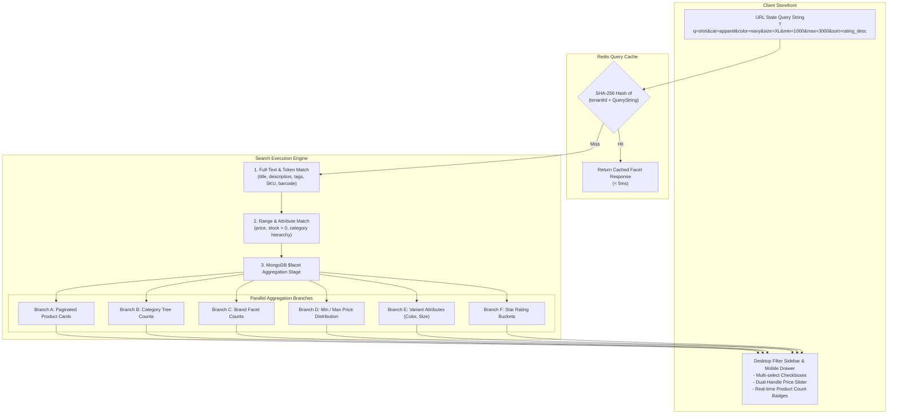
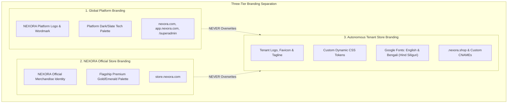
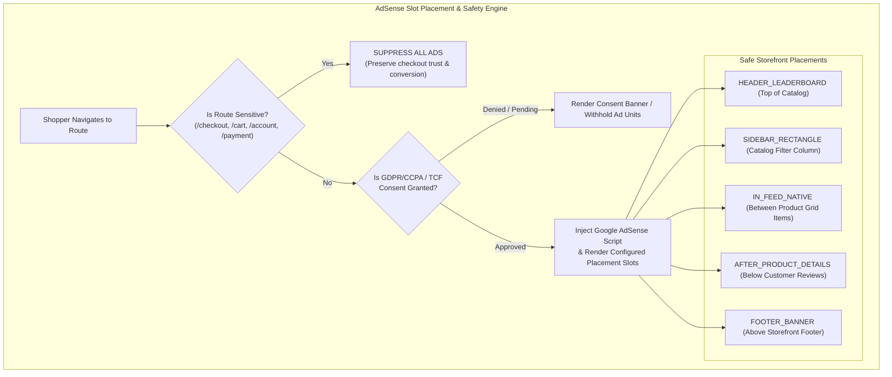

# Search, Branding & Advertisement Architecture
## Document Version: 1.0.0 — Phase 01 Master Architecture
**Platform**: NEXORA Multi-Tenant SaaS E-Commerce Store Builder  
**Author**: Principal Software Architect & Senior Frontend Architect  
**Status**: APPROVED

---

## 1. Advanced Search & Filtering Architecture

A high-converting e-commerce platform requires sub-100ms multi-faceted product searching and filtering. NEXORA achieves this using a MongoDB Faceted Aggregation Pipeline backed by compound indexes and Redis query fingerprint caching.



### 1.1 MongoDB Faceted Aggregation Pipeline Specification
A single query execution returns both the filtered result set and dynamic facet counts for UI checkboxes:

```javascript
// Architecture Specification: Product Facet Aggregation
const aggregationPipeline = [
  // Stage 1: Tenant Boundary & Base Criteria
  {
    $match: {
      tenantId: ctx.tenantId,
      status: 'ACTIVE',
      ...(searchQuery ? { $text: { $search: searchQuery } } : {}),
      ...(categoryId ? { categoryId: categoryObjectId } : {}),
      basePrice: { $gte: minPrice, $lte: maxPrice }
    }
  },
  // Stage 2: Parallel Faceting
  {
    $facet: {
      products: [
        { $sort: sortStage },
        { $skip: (page - 1) * pageSize },
        { $limit: pageSize },
        {
          $project: {
            title: 1, slug: 1, basePrice: 1, compareAtPrice: 1,
            images: { $slice: ['$images', 2] }, totalStock: 1,
            averageRating: 1, reviewCount: 1, sku: 1
          }
        }
      ],
      totalCount: [{ $count: 'count' }],
      categoryFacets: [
        { $group: { _id: '$categoryId', count: { $sum: 1 } } }
      ],
      brandFacets: [
        { $match: { brandId: { $ne: null } } },
        { $group: { _id: '$brandId', count: { $sum: 1 } } }
      ],
      priceStats: [
        {
          $group: {
            _id: null,
            min: { $min: '$basePrice' },
            max: { $max: '$basePrice' }
          }
        }
      ],
      ratingFacets: [
        {
          $bucket: {
            groupBy: '$averageRating',
            boundaries: [0, 2, 3, 4, 5],
            default: 'other',
            output: { count: { $sum: 1 } }
          }
        }
      ]
    }
  }
];
```

---

## 2. Three-Tier Branding & Theme Engine

Branding in NEXORA is strictly hierarchical and isolated across three distinct spheres:



### 2.1 Dynamic CSS Variable Generation
The storefront injects design tokens at runtime via a single injected `<style id="nexora-theme-tokens">` tag, enabling instant theme updates without rebuilding frontend bundles:

```css
:root {
  --nexora-primary: #1E293B;
  --nexora-primary-fg: #FFFFFF;
  --nexora-secondary: #F1F5F9;
  --nexora-accent: #3B82F6;
  --nexora-background: #FFFFFF;
  --nexora-surface: #F8FAFC;
  --nexora-border: #E2E8F0;
  --nexora-font-heading: 'Plus Jakarta Sans', sans-serif;
  --nexora-font-body: 'Inter', sans-serif;
  --nexora-radius: 0.5rem;
}
```

### 2.2 Theme Draft, Preview, Publish & Rollback Lifecycle
1. **Draft Mode**: Store owner edits colors, typography, and logo in the Theme Studio. Edits save to `theme_configs.draftSnapshot`.
2. **Interactive Preview**: Live iframe loads storefront with `?preview_theme=draft&token=<signed_hmac>`, rendering unpublished changes in real-time.
3. **Publish Event**:
   - Creates a new revision record in `theme_revisions` containing the snapshot, user ID, and timestamp.
   - Promotes `draftSnapshot` to `publishedSnapshot`.
   - Flushes Redis cache key `tenant:theme:<tenantId>`.
4. **Instant Rollback**: Merchant can select any previous revision from the version history table and click "Restore", reverting the active storefront in < 50ms.

---

## 3. Google AdSense & Advertisement Architecture

NEXORA allows merchants on eligible subscription plans to monetize their traffic through Google AdSense or custom promotional banners while strictly safeguarding user privacy and conversion-critical checkout flows.



### 3.1 Strict Security & Policy Boundaries
1. **Protected Path Blacklist**:
   AdSense scripts and ad units are **STRICTLY FORBIDDEN** from rendering on:
   - `/cart`
   - `/checkout/*`
   - `/payment/*`
   - `/orders/confirmed`
   - `/account/*` (Login, Register, Password Reset, MFA)
   - Merchant Admin Dashboard (`/admin/*`)
2. **Tenant Ad Isolation**:
   - Publisher IDs (`ca-pub-XXXXXXXXXXXXXXXX`) are stored strictly within the tenant's `ad_configs` record.
   - Tenant A's publisher ID will never appear on Tenant B's store.
   - AdSense auto-ads can be toggled independently of manual ad unit slots.
3. **Consent Management Integration**:
   Complies with Google's EU User Consent Policy and IAB Transparency and Consent Framework (TCF v2.2), preventing ad script loading until user consent is captured.
