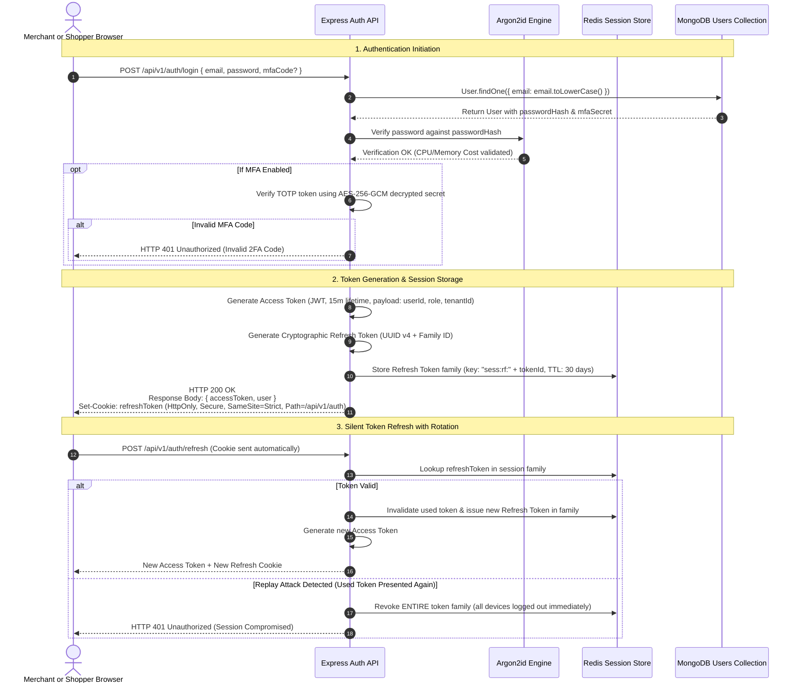
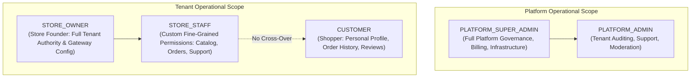
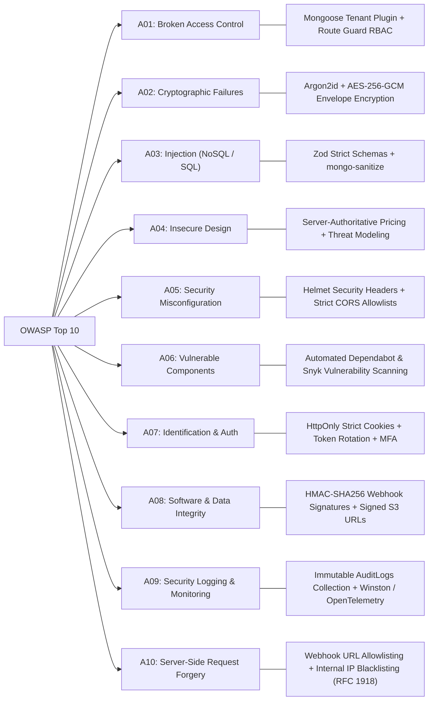

# Security Threat Model, Authentication & RBAC Architecture
## Document Version: 1.0.0 — Phase 01 Master Architecture
**Platform**: NEXORA Multi-Tenant SaaS E-Commerce Store Builder  
**Author**: Principal Security Architect & Lead DevSecOps Engineer  
**Status**: APPROVED

---

## 1. STRIDE Threat Modeling Matrix

We conducted a STRIDE threat modeling analysis across NEXORA's multi-tenant architecture:

| STRIDE Category | Threat Scenario | Specific Impact | NEXORA Architectural Mitigation |
| :--- | :--- | :--- | :--- |
| **Spoofing Identity** | Attacker crafts forged JWT or falsifies tenant identification header (`X-Tenant-ID`) to access another merchant's dashboard. | Unauthorized store takeover, data theft, fraudulent order fulfillment. | **Zero-Trust Token & Host Validation**: Tenant identity is resolved strictly via cryptographically validated TLS Host headers and signed JWT payload claims verified against Redis active session tokens. Client-supplied headers are never used as authoritative tenant IDs. |
| **Tampering With Data** | Shopper alters product unit price or discount in the cart payload (`price: 1.00 BDT`) before submitting the order. | Financial loss from unauthorized price manipulation. | **Server-Authoritative Pricing**: The order creation endpoint accepts only `{ variantId, quantity }`. The server fetches the authoritative price directly from the database within an ACID transaction and recalculates discounts, tax, and totals server-side. |
| **Repudiation** | Rogue staff user deletes store inventory or modifies payment credentials and denies the action. | Inability to audit internal fraud or prove accountability. | **Immutable Audit Log**: Every administrative mutation generates an append-only audit event in the `AuditLogs` collection containing `actorUserId`, `tenantId`, `ipAddress`, `userAgent`, timestamp, and before/after JSON diffs. |
| **Information Disclosure** | Merchant queries `/api/v1/tenant/products` and manipulates query parameters to extract products or orders from another tenant. | Severe confidentiality breach, cross-tenant data leak. | **Mongoose Query Interceptor Plugin**: The database layer unconditionally injects `{ tenantId: ctx.tenantId }` into all read and write queries, preventing cross-tenant leakage even if an endpoint developer omits manual filtering. |
| **Denial of Service** | Malicious bot floods checkout endpoints with automated requests, exhausting connection pools or bKash API quotas. | Storefront downtime, legitimate shoppers unable to purchase. | **Multi-Tier Rate Limiting**: Redis-backed sliding window rate limiter: IP-level (60 req/min for public browsing), Tenant-level (10 req/min for checkout initiation), and Cloudflare WAF bot mitigation. |
| **Elevation of Privilege** | Store staff user assigned to "Product Editor" role calls the endpoint to modify payment gateway credentials. | Staff member redirects store revenue to their personal bKash/bank account. | **Granular RBAC Middleware**: Every route declares required permission flags (e.g., `REQUIRE_PERMISSION('PAYMENTS_MANAGE')`). Token claims are verified against the tenant's membership role. |

---

## 2. Authentication & Session Architecture

NEXORA implements a modern, bank-grade authentication lifecycle separating volatile access tokens from high-security refresh tokens:



### 2.1 Password Hashing Specification
NEXORA strictly utilizes **Argon2id** (the winner of the Password Hashing Competition), offering maximum resistance against both GPU/ASIC brute-force and side-channel cache attacks.
- **Algorithm**: `argon2id`
- **Memory Cost (`m`)**: 65,536 KiB (64 MiB)
- **Time Cost (`t`)**: 3 iterations
- **Parallelism (`p`)**: 4 threads
- **Salt Length**: 16 cryptographically random bytes (`crypto.randomBytes(16)`)

### 2.2 Dual-Token & Cookie Security Attributes
- **Access Token**:
  - Format: JWT signed with asymmetric ECDSA (`ES256`) or HMAC (`HS256` with 512-bit secret).
  - Lifetime: 15 minutes.
  - Storage: In-memory JavaScript state (never stored in `localStorage` or `sessionStorage` to eliminate XSS token theft).
- **Refresh Token**:
  - Format: High-entropy cryptographically random string (256 bits).
  - Lifetime: 30 days with rolling extension on active usage.
  - Delivery: Transmitted exclusively in an HTTP Response Header:
    ```http
    Set-Cookie: nexora_rt=d3b07384...; Max-Age=2592000; Path=/api/v1/auth; HttpOnly; Secure; SameSite=Strict
    ```
  - Protection: Inaccessible to JavaScript `document.cookie` (immune to XSS extraction).

---

## 3. Role-Based Access Control (RBAC) & Permission Matrix

NEXORA defines 5 distinct role tiers across Platform and Tenant scopes:



### 3.1 Permission Entitlement Matrix

| Resource & Operation | PLATFORM_SUPER_ADMIN | PLATFORM_ADMIN | STORE_OWNER | STORE_STAFF | CUSTOMER |
| :--- | :---: | :---: | :---: | :---: | :---: |
| **Manage Subscription Plans** |  Full |  Read Only |  No Access |  No Access |  No Access |
| **Suspend / Reactivate Tenant** |  Full |  Full |  No Access |  No Access |  No Access |
| **View Platform Global Revenue** |  Full |  No Access |  No Access |  No Access |  No Access |
| **Manage Payment Gateway Keys** |  No Access |  No Access |  Full (Tenant) |  No Access |  No Access |
| **Create / Edit Products** |  Audit Only |  Audit Only |  Full |  Configurable |  No Access |
| **Process Orders & Refunds** |  Audit Only |  Audit Only |  Full |  Configurable |  No Access |
| **Customize Theme & Branding** |  No Access |  No Access |  Full |  Configurable |  No Access |
| **Manage Store Staff Users** |  No Access |  No Access |  Full |  No Access |  No Access |
| **Place Storefront Order** |  N/A |  N/A |  Allowed |  Allowed |  Full |
| **View Personal Order History**|  N/A |  N/A |  N/A |  N/A |  Self Only |

---

## 4. OWASP Top 10 Security Architecture Mitigations



1. **A01: Broken Access Control & IDOR Protection**:
   - Every lookup query asserts ownership: `Order.findOne({ _id: orderId, tenantId: ctx.tenantId })`. If a customer or merchant requests an ID belonging to another tenant or customer, the query returns `404 Not Found` rather than `403 Forbidden` to avoid leaking resource existence.
2. **A02: Cryptographic Failures**:
   - Tenant gateway credentials (bKash app secret, Stripe secret key) are encrypted at rest with **AES-256-GCM**.
   - A unique 96-bit Initialization Vector (IV) and 128-bit authentication tag are generated per secret and verified before decryption.
3. **A03: Injection Protection (NoSQL & XSS)**:
   - All input objects are sanitized via `express-mongo-sanitize` to strip any keys containing `$` or `.`.
   - Rich text inputs (e.g., product descriptions) are sanitized with `DOMPurify` using an explicit allowlist of safe HTML tags (`<p>`, `<b>`, `<i>`, `<ul>`, `<li>`, ``).
4. **A07: SSRF Protection for Webhooks**:
   - Outgoing webhooks validate URLs against private IP ranges (`10.0.0.0/8`, `172.16.0.0/12`, `192.168.0.0/16`, `127.0.0.0/8`, `169.254.169.254`). Outbound calls to cloud metadata endpoints are hard-blocked at the network egress level.
