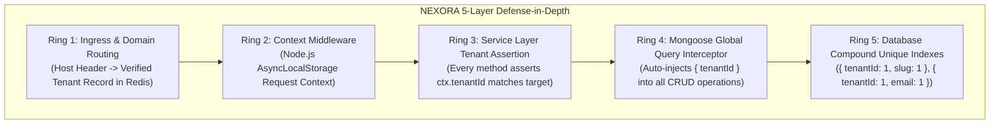
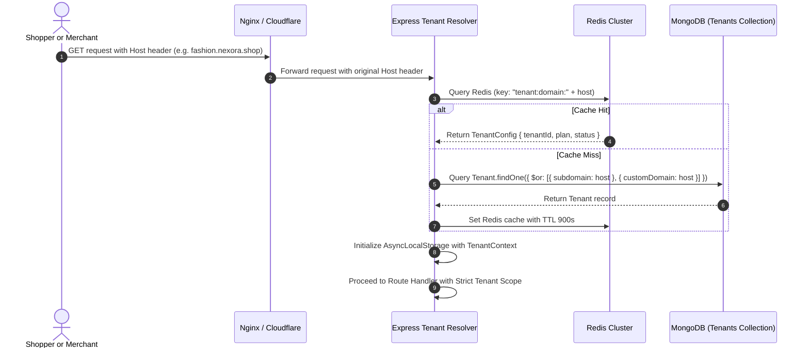
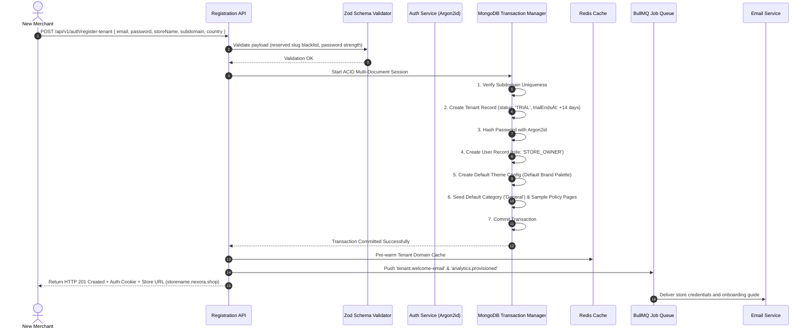
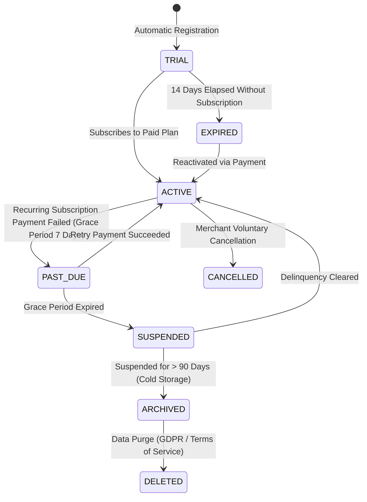

# Multi-Tenant Architecture & Lifecycle Specification
## Document Version: 1.0.0 — Phase 01 Master Architecture
**Platform**: NEXORA Multi-Tenant SaaS E-Commerce Store Builder  
**Author**: Principal Software Architect & Database Architect  
**Status**: APPROVED

---

## 1. Multi-Tenant Architectural Pattern Evaluation

When designing multi-tenant architectures, three primary models exist. For NEXORA, we evaluated all three against scale, cost, MongoDB characteristics, operational complexity, and data isolation requirements:

| Architectural Pattern | Description | Pros | Cons | NEXORA Decision |
| :--- | :--- | :--- | :--- | :--- |
| **A. Database-Per-Tenant** | Each tenant has a separate MongoDB database (`db_tenant_123`). | Absolute physical isolation; simple backup per tenant. | Extreme connection pool overhead; resource exhaustion at 1,000+ tenants; migrations must run across thousands of DBs; high infrastructure cost. | **Rejected** for general tenants; reserved only for high-tier Dedicated Enterprise contracts. |
| **B. Collection-Per-Tenant** | Shared DB, but separate collections (`products_tenant123`, `orders_tenant123`). | Namespace separation. | MongoDB collection count limits; index memory explosion; schema migration nightmare. | **Rejected**. |
| **C. Shared Database, Shared Collections with Logical Discriminator & AsyncLocalStorage Context** | Shared collections (`Products`, `Orders`) where every record has a mandatory, indexed `tenantId: ObjectId`. | Near-infinite horizontal scalability; predictable memory footprint; centralized schema migrations; cost-effective. | Requires zero-defect tenant isolation at the application layer to prevent data leakage. | **SELECTED (Gold Standard)** with Kernel-Level Interceptors. |

---

## 2. Multi-Tenant Isolation: The Defense-in-Depth Model

To prevent cross-tenant data leakage (the cardinal failure mode of SaaS), NEXORA enforces **5 concentric rings of isolation**:



### 2.1 AsyncLocalStorage Tenant Context Pattern
Node.js `AsyncLocalStorage` creates an execution context that follows asynchronous call stacks without manually passing `tenantId` through dozens of helper functions:

```typescript
// Conceptual Architecture Implementation
import { AsyncLocalStorage } from 'node:async_hooks';

export interface TenantContext {
  tenantId: string;
  subdomain: string;
  customDomain?: string;
  planId: string;
  status: 'ACTIVE' | 'TRIAL' | 'PAST_DUE' | 'SUSPENDED';
  currency: string;
  timezone: string;
}

export const tenantStorage = new AsyncLocalStorage<TenantContext>();

export function getTenantContext(): TenantContext {
  const context = tenantStorage.getStore();
  if (!context) {
    throw new SecurityException('CRITICAL_SECURITY_VIOLATION: Missing Tenant Context in execution path');
  }
  return context;
}
```

### 2.2 Global Mongoose Query Interceptor Plugin
Every multi-tenant schema registers a mandatory Mongoose plugin that intercepts queries and automatically binds `tenantId`:

```typescript
// Architecture pattern for Mongoose Plugin
export function tenantIsolationPlugin(schema: mongoose.Schema) {
  schema.add({
    tenantId: {
      type: mongoose.Schema.Types.ObjectId,
      ref: 'Tenant',
      required: true,
      index: true,
    },
  });

  const queryMethods = ['find', 'findOne', 'countDocuments', 'updateMany', 'updateOne', 'deleteMany', 'deleteOne'] as const;

  queryMethods.forEach((method) => {
    schema.pre(method, function () {
      const ctx = tenantStorage.getStore();
      if (!ctx && !this.getOptions().bypassTenantCheck) {
        throw new Error('Tenant context missing from query execution');
      }
      if (ctx && !this.getOptions().bypassTenantCheck) {
        this.where({ tenantId: ctx.tenantId });
      }
    });
  });
}
```

---

## 3. Tenant Resolution Mechanisms

Incoming HTTP requests are resolved to a tenant through a hierarchical pipeline:



### Domain Classification:
1. **Platform Root Domain (`nexora.com`, `app.nexora.com`)**:
   - Resolves to Platform Admin Portal and SaaS Landing Site.
   - Tenant Context is null or set to `PLATFORM_SYSTEM`.
2. **Official Store Domain (`store.nexora.com`)**:
   - Resolves to Tenant Record `T_NEXORA_OFFICIAL`.
3. **Tenant Subdomain (`<tenant-slug>.nexora.shop`)**:
   - Resolves via wildcard DNS `*.nexora.shop`.
   - Extracted slug queries Redis cache in < 1ms.
4. **Tenant Custom Top-Level Domain (`www.merchantbrand.com` / `store.merchant.bd`)**:
   - Merchant configures DNS: `CNAME` pointing to `domains.nexora.shop` or `A` record pointing to NEXORA Ingress Anycast IP.
   - Nginx / OpenResty checks certificate cache. If missing, triggers asynchronous Let's Encrypt SSL auto-issuance via ACME HTTP-01 challenge.
   - Custom domain record mapped to verified `tenantId` in the `Domains` collection.

---

## 4. Tenant Store Creation & Provisioning Flow

Tenant store creation is completely automated upon merchant registration without requiring manual platform administrator intervention.



### Blacklisted Subdomains (Strict System Reserve):
The tenant creation engine rejects any registration attempting to use system-reserved slugs:
`api`, `app`, `admin`, `superadmin`, `dashboard`, `portal`, `store`, `shop`, `official`, `billing`, `webhook`, `status`, `mail`, `dev`, `staging`, `test`, `help`, `support`, `docs`, `assets`, `cdn`, `auth`, `login`.

---

## 5. Tenant Lifecycle State Machine



### State Policies:
- **TRIAL / ACTIVE**: Full access to storefront, checkout, and admin dashboard according to plan entitlements.
- **PAST_DUE**: Storefront remains accessible to customers to avoid immediate business disruption; merchant dashboard displays persistent settlement banner.
- **SUSPENDED**: Storefront displays graceful maintenance page (`"This store is temporarily unavailable"`). No orders can be placed. Merchant dashboard restricted to Billing Management.
- **ARCHIVED**: Catalog and historical orders backed up to cold compressed storage; domain routing freed.
